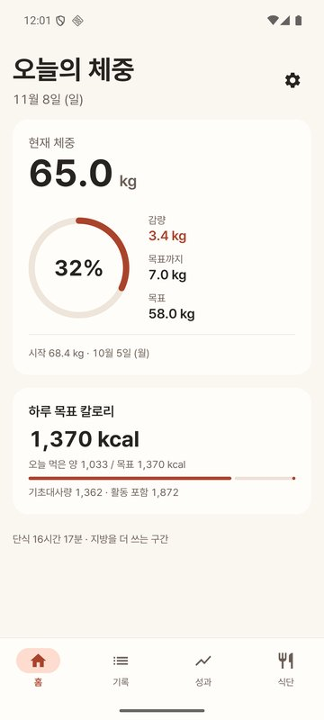
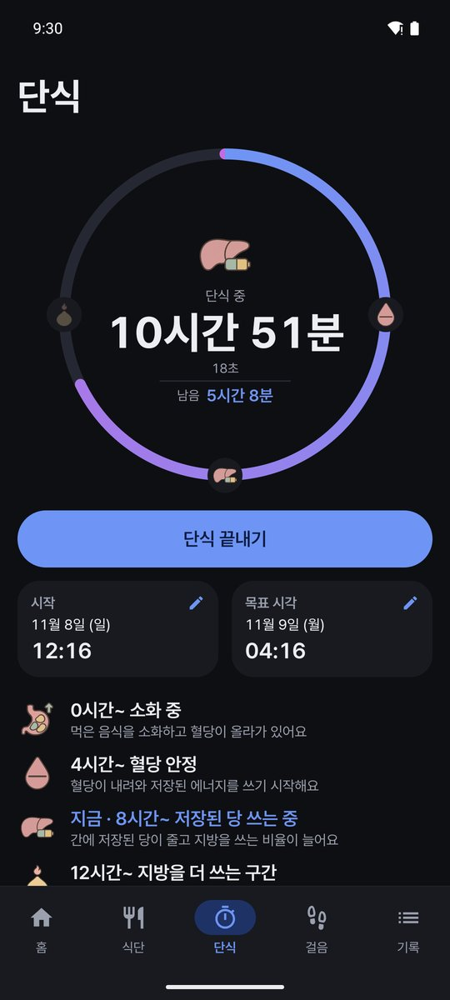
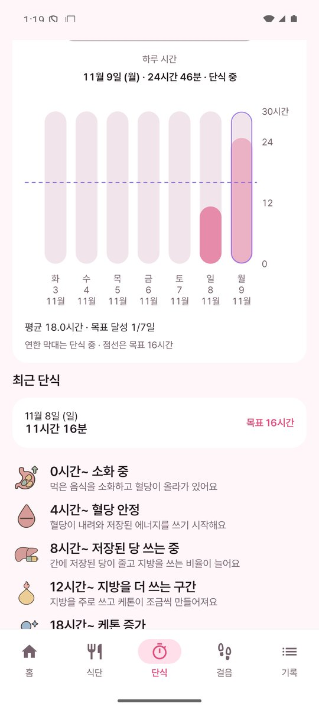
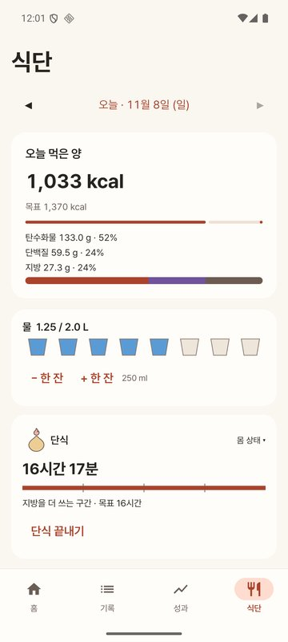
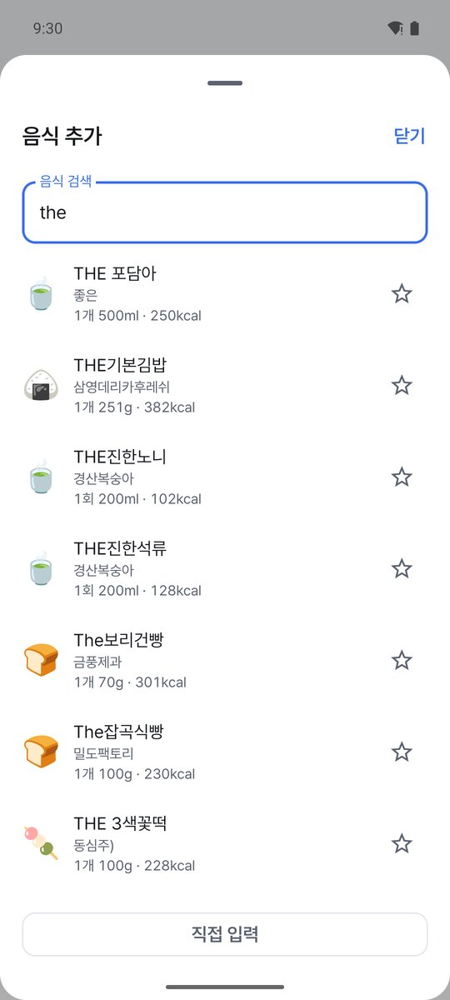
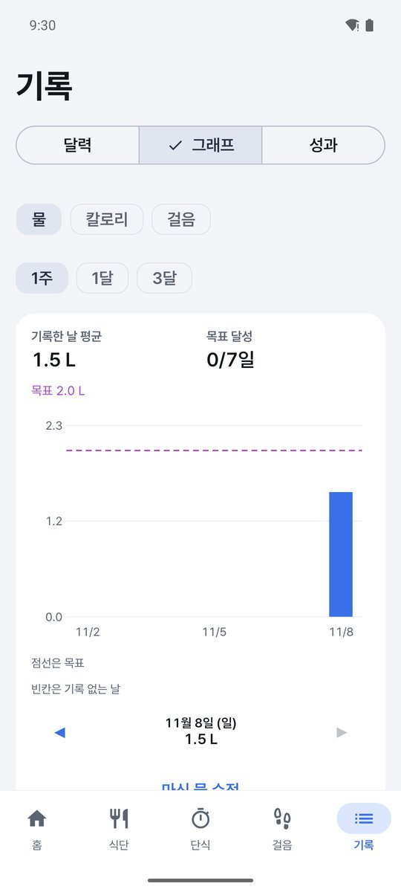
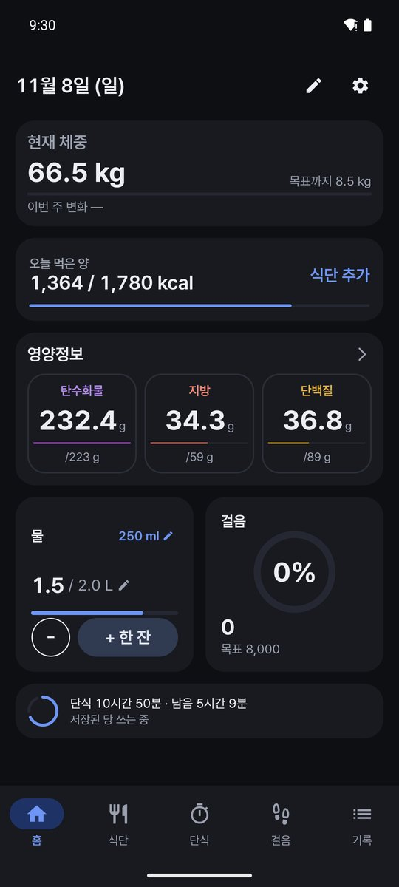
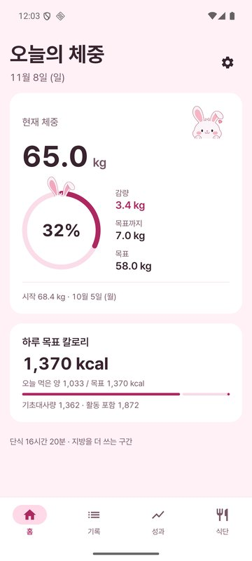
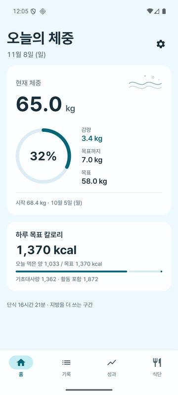

# 가볍게

체중과 식단을 기록하고, 목표까지 얼마나 왔는지 한눈에 보는 안드로이드 앱입니다.
로그인 없이 바로 쓸 수 있고, 원하면 Google 계정으로 백업하고 여러 기기에서 이어 쓸 수 있습니다.

**[APK 내려받기 (최신 버전)](https://github.com/adgjmptw2/gabyeop/releases/latest)**

<p>
  
  
  
  
  
</p>
<p>
  
  
  
  
</p>

## 기능

아래 탭은 홈 · 식단 · 단식 · 걸음 · 기록 다섯 개입니다.

- **홈**: 하루를 한 화면에 모았습니다. 체중과 목표까지 남은 무게, 오늘 먹은 칼로리, 물, 걸음, 영양제, 진행 중인 단식을 보여 줍니다. 카드를 누르면 해당 탭이나 그래프로 이동합니다.
  - 물은 홈에서 바로 `+ 한 잔`으로 추가하고 되돌릴 수 있습니다. 한 잔 크기(50~2,000 ml)와 마신 양은 숫자를 눌러 바로 고칩니다.
- **식단**: 끼니별 기록, 영양정보(탄수화물·지방·단백질 g / 목표 g), 사진 첨부, 즐겨찾기, 내 음식(브랜드·맛, 팩·개·g·ml 단위)
  - 식약처 데이터 약 33만 개(음식 1만 7천, 원재료 3천 7백, 가공식품 30만)를 인터넷 없이 검색합니다. 제품은 `1개 (100g)`, `1회 (30g)`로 양을 고릅니다.
  - 검색 결과가 없으면 검색어를 이름에 넣은 채로 직접 입력을 엽니다.
- **영양정보 목표**: 탄수화물·지방·단백질 하루 목표 g. 직접 정하지 않으면 하루 목표 칼로리의 50:30:20(탄:지:단, 열량 비율)으로 계산한 추천값을 씁니다. 추천값은 목표 설정 화면에서만 보여 줍니다.
- **영양제**: 먹는 영양제를 등록해 두고 아침·점심·저녁으로 나눠 칩을 한 번 눌러 그날 먹었는지 체크합니다(홈·식단·하루 보기). 설정에서 하루 한 번 체크로 바꿀 수 있고, 기기에만 저장합니다.
- **단식**: 원형 타이머(구간 그림이 링 위에 표시), 시작 시각 고르기(날짜·시·분), 날마다 단식한 시간 막대 그래프(주·월·년), 끝내기 되돌리기, 목표 1~72시간, 지난 시간에 따른 몸 상태 6구간 설명, 목표 시간 알림
- **걸음**: Health Connect(삼성 헬스·구글 핏 걸음 포함)에서 읽고, 쓸 수 없으면 폰 걸음 센서로 셉니다. 오늘 걸음·목표·대략 거리와 소모 kcal, 최근 1주·1달 막대. 걸음 기록은 기기에만 둡니다.
- **기록**: 한 탭 안에서 달력 · 그래프 · 성과를 고릅니다.
  - 달력(일·주·월): 날짜 밑에 그날 먹은 kcal, 날마다 체중·체지방률·메모. BMI는 키와 체중으로 자동 계산(대한비만학회 구간), 체지방률은 직접 입력하고 비워 두면 Deurenberg 식 추정치만 보여 줍니다.
  - 그래프: 물·칼로리·걸음·단식을 막대로, 목표선·기록한 날 평균·목표 달성 일수
  - 성과: 체중 곡선(7일 평균선), 체지방률 곡선, 최근 4주 추세로 계산한 목표 도달 예상일, 배지
- **하루 목표 칼로리**: 기본은 Mifflin-St Jeor로 계산한 권장량, 설정에서 직접 정할 수 있습니다.
- **테마**: 라이트·다크·토끼·오션
- **설정**: 게스트 모드(기기에만 저장) 또는 Google 로그인(서버 백업·동기화), 기록 알림, CSV 내보내기, 기기 기록 지우기, 계정 삭제

## 구조

```
app/      Android 앱 (Kotlin, Jetpack Compose)
server/   동기화 서버 (Cloudflare Workers + D1, TypeScript)
tools/    식품 목록(catalog.db) 만드는 스크립트 (Python)
store/    스토어 등록 자료
```

### Android

- Kotlin 2.4, Jetpack Compose(Material 3), Hilt, Room, DataStore, WorkManager, OkHttp, kotlinx.serialization, Health Connect
- minSdk 26·targetSdk 36
- 화면 → ViewModel(StateFlow) → Repository → Room. 계산 규칙(칼로리, 진행률, 주간·월간 변화, 추세, 배지, BMI, 탄단지 비율·추천 목표, 물 목표, 단식 구간, 그래프 집계, 걸음 거리·kcal)은 `domain/`의 순수 함수로 두고 단위 테스트로 확인합니다.
- 식품 목록은 읽기 전용 SQLite(`assets/catalog.db`, 약 70MB)로 넣고, 처음 실행할 때 앱 폴더로 한 번 복사해 엽니다. 업데이트로 목록이 바뀌면 다시 복사합니다.
  - 검색은 이름+업체에서 공백을 뺀 좁은 검색 표만 훑습니다. 검색어를 띄어쓰기로 나눠 모두 포함하는 것을 고르고, 정확히 일치 → 앞부분 일치 → 짧은 이름 순으로 정렬합니다(33만 개에서 PC 기준 약 50ms).
  - 내 음식은 Room에 두고 항상 맨 앞에 보여 줍니다. 목록 음식을 기록하거나 즐겨찾기하면 그 줄만 Room에 복사해 최근 음식·즐겨찾기가 그대로 동작합니다.
- 걸음은 Health Connect의 걸음 기록을 날짜별로 합산해 읽습니다. 센서 방식은 부팅 후 누적값을 15분마다(WorkManager) 기록해 날짜별 차이를 더하고, 재부팅으로 값이 줄면 그때부터 다시 셉니다.
- 1.1 → 1.2 → 1.3 업데이트는 Room 3→4→5 AutoMigration(칸·표 추가만)과 기존 DataStore 키 유지로 게스트 기록을 그대로 옮깁니다.

### 로그인과 동기화

- Credential Manager로 Google ID 토큰을 받아 서버에서 검증(RS256, `aud`·`iss`·`exp`)한 뒤, 서버가 발급한 토큰으로 통신합니다.
  - 접근 토큰: HS256 JWT, 15분
  - 갱신 토큰: 60일, 쓸 때마다 새로 발급하고, 이미 쓴 토큰이 다시 오면 그 계열 전체를 무효로 만듭니다.
  - 기기에는 Android Keystore(AES-GCM)로 암호화해 저장하고 백업에서 제외합니다.
- 동기화는 요청 한 번에 보내기와 받기를 함께 처리합니다.
  - 모든 행에 UUID와 `updatedAt`을 두고 마지막에 고친 값을 남깁니다(LWW). 삭제는 행을 지우지 않고 삭제 표시만 남깁니다.
  - 서버는 변경마다 일련번호(seq)를 붙이고, 앱은 마지막으로 받은 번호 이후만 받습니다(한 번에 최대 2,000건).
  - 같은 날 체중이 두 기기에서 따로 기록되면 서버가 하나만 남기고 나머지는 삭제 표시로 돌려줍니다.
  - 체중·식단·프로필·하루 메모(물 포함)·단식 다섯 종류를 한 커서로 받습니다.
  - 응답에 프로토콜 버전을 넣어, 아직 업데이트되지 않은 서버와는 보낸 것으로 처리하지 않습니다. 옛 버전 앱이 보내지 않은 새 항목은 서버가 지우지 않고 그대로 둡니다.
  - 로그아웃 뒤 다른 Google 계정으로는 이 기기 기록을 올리지 않습니다(기록을 지우거나 원래 계정으로 로그인).
- 앱은 기기 DB를 먼저 쓰고, 동기화는 WorkManager가 앱을 열 때, 기록을 고친 뒤, 하루 한 번 백그라운드에서 맞춥니다.
- 서버는 상시 켜 두는 컴퓨터 없이 Cloudflare Workers 무료 범위에서 돕니다. 동기화 한 번이 D1 batch 1~2번입니다.

## 테스트

- 앱 247개: 칼로리·진행률·주간·월간 변화·추세·배지·BMI·탄단지 추천 목표·물·단식 구간·단식 그래프 집계·걸음 계산, 영양제 이름·순서·체크, 식품 검색 정렬과 옛 음식 정리, 입력 검증, 동기화 병합과 옛 버전 호환, 계정 바뀜 차단 (`app/src/test`)
- 서버 62개: JWT, 갱신 토큰 회전·재사용 감지, 입력 검증, 같은 날 체중 충돌, 단식 충돌, 페이지 나누기, 옛 버전 앱 요청 시 새 항목 보존 (`server/test`)

## 빌드

```sh
# 식품 목록 만들기 (처음 한 번, 공공데이터포털에서 받음 → app/src/main/assets/catalog.db)
python -I tools/build_catalog.py

# Android (JDK 21)
./gradlew :app:testDebugUnitTest
./gradlew :app:assembleRelease      # 서명 설정: keystore.properties 경로를 diet.keystoreProperties로 지정

# 서버
cd server
npm install
npm run typecheck && npm test
```

`gradle.properties`의 `diet.apiBaseUrl`·`diet.googleWebClientId`를 비우면 게스트 전용으로 빌드됩니다. 서버 배포 순서는 [server/README.md](server/README.md)에 있습니다.

## 데이터와 라이선스

- 식품 데이터: 식품의약품안전처 「전국통합식품영양성분정보」 음식·가공식품·원재료성식품 표준데이터(공공데이터포털)
- 글꼴: [Pretendard](https://github.com/orioncactus/pretendard) 서브셋(SIL OFL 1.1, 이름은 AppSans로 바꿈)
- 토끼 장식과 단식 구간 그림은 이미지 생성 모델로 만들었습니다. 구간 설명은 일반적인 안내이며 의료 조언이 아닙니다.
- 사용한 라이브러리 목록은 앱의 설정 → 오픈소스·데이터 출처에 있습니다.

## 개인정보

- 게스트: 기록은 기기에만 저장되고 서버로 보내지 않습니다. 모든 서버 요청은 Google 로그인 상태에서만 나가도록 한 곳에서 막습니다.
- 걸음 수와 영양정보 목표는 로그인 여부와 상관없이 기기에만 둡니다.
- Google 로그인: 계정 식별자·이메일과 체중·체지방률·식단·프로필·하루 메모·물·단식을 동기화용으로 저장합니다. 사진은 서버로 올리지 않습니다.
- 개인정보처리방침: https://gabyeop-api.rlawjdgus2900.workers.dev/privacy
