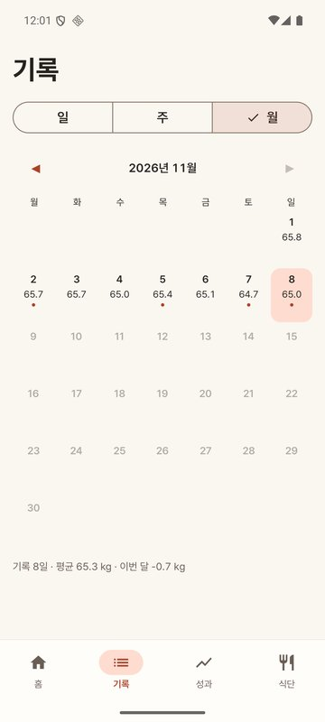
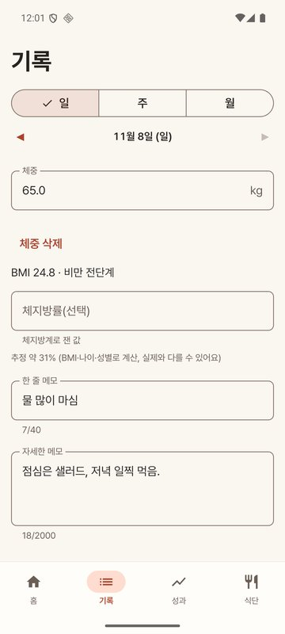
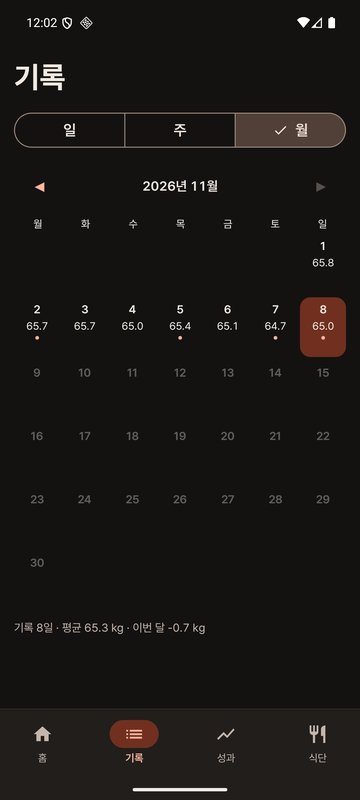

# 가볍게

체중과 식단을 기록하고, 목표까지 얼마나 왔는지 한눈에 보는 안드로이드 앱입니다.
로그인 없이 바로 쓸 수 있고, 원하면 Google 계정으로 백업하고 여러 기기에서 이어 쓸 수 있습니다.

<p>
  
  
  
  
</p>
<p>
  
  
  
  
</p>

## 기능

- **홈**: 현재 체중, 감량한 양, 목표까지 남은 무게와 진행률, 하루 목표 칼로리, 진행 중인 단식
- **기록**: 달력(일·주·월, 기본 월)에서 날마다 체중과 메모를 봅니다. 하루 보기에서 체중·체지방률·메모를 기록하고 그날 식단과 탄수화물·단백질·지방을 봅니다.
  - BMI는 키와 체중으로 자동 계산(대한비만학회 구간)
  - 체지방률은 직접 입력. 비워 두면 Deurenberg 식 추정치를 보여 주기만 하고 저장하지 않습니다.
- **성과**: 체중 곡선(7일 평균선), 체지방률 곡선, 최근 4주 추세로 계산한 목표 도달 예상일, 배지
- **식단**: 식약처 음식 영양성분 데이터 1만 7천여 개 검색(인터넷 없이), 음식별 이모지 자동 표시, 사진 첨부
  - 즐겨찾기, 내 음식(브랜드·맛, 팩·개·g·ml 단위)
  - 탄수화물·단백질·지방을 g과 열량 비율(%)로 표시
  - 물: 한 번 눌러 한 잔씩, 목표는 체중으로 자동 계산하거나 직접 입력
  - 단식 타이머: 시작·끝내기, 시작 시각 고치기, 지난 시간에 따른 몸 상태 6구간(그림), 목표 시간 알림
- **하루 목표 칼로리**: 기본은 Mifflin-St Jeor로 계산한 권장량, 설정에서 직접 정해도 권장량을 같이 보여 줍니다.
- **테마**: 라이트·다크·토끼·오션
- **설정**: 게스트 모드(기기에만 저장) 또는 Google 로그인(서버 백업·동기화), 기록 알림, CSV 내보내기, 기기 기록 지우기, 계정 삭제

물·단식 같은 기능은 화면을 따로 늘리지 않고 기존 탭의 카드 안에서 펼쳐지게 만들었습니다.

## 구조

```
app/      Android 앱 (Kotlin, Jetpack Compose)
server/   동기화 서버 (Cloudflare Workers + D1, TypeScript)
tools/    음식 데이터 변환 스크립트 (Python)
store/    스토어 등록 자료
```

### Android

- Kotlin 2.4, Jetpack Compose(Material 3), Hilt, Room, DataStore, WorkManager, OkHttp, kotlinx.serialization
- minSdk 26·targetSdk 36
- 화면 → ViewModel(StateFlow) → Repository → Room. 계산 규칙(칼로리, 진행률, 주간·월간 변화, 추세, 배지, BMI, 탄단지 비율, 물 목표, 단식 구간)은 `domain/`의 순수 함수로 두고 단위 테스트로 확인합니다.
- 음식 데이터는 앱에 압축해 넣고 처음 실행할 때 Room으로 옮깁니다. 검색은 이름·대표식품명·브랜드를 일치 정도로 정렬하는 SQL 하나로 처리합니다.

### 로그인과 동기화

- Credential Manager로 Google ID 토큰을 받아 서버에서 검증(RS256, `aud`·`iss`·`exp`)한 뒤, 서버가 발급한 토큰으로 통신합니다.
  - 접근 토큰: HS256 JWT, 15분
  - 갱신 토큰: 60일, 쓸 때마다 새로 발급하고, 이미 쓴 토큰이 다시 오면 그 계열 전체를 무효로 만듭니다.
  - 기기에는 Android Keystore(AES-GCM)로 암호화해 저장하고 백업에서 제외합니다.
- 동기화는 요청 한 번에 보내기와 받기를 함께 처리합니다.
  - 모든 행에 UUID와 `updatedAt`을 두고 마지막에 고친 값을 남깁니다(LWW). 삭제는 행을 지우지 않고 삭제 표시만 남깁니다.
  - 서버는 변경마다 일련번호(seq)를 붙이고, 앱은 마지막으로 받은 번호 이후만 받습니다(한 번에 최대 2,000건).
  - 같은 날 체중이 두 기기에서 따로 기록되면 서버가 하나만 남기고 나머지는 삭제 표시로 돌려줍니다.
  - 체중·식단·프로필·하루 메모(물 포함)·단식 다섯 종류를 한 커서로 받습니다.
  - 응답에 프로토콜 버전을 넣어, 아직 업데이트되지 않은 서버와는 보낸 것으로 처리하지 않습니다. 옛 버전 앱이 보내지 않은 새 항목은 서버가 지우지 않고 그대로 둡니다.
  - 로그아웃 뒤 다른 Google 계정으로는 이 기기 기록을 올리지 않습니다(기록을 지우거나 원래 계정으로 로그인).
- 앱은 기기 DB를 먼저 쓰고, 동기화는 WorkManager가 앱을 열 때, 기록을 고친 뒤, 하루 한 번 백그라운드에서 맞춥니다.
- 서버는 상시 켜 두는 컴퓨터 없이 Cloudflare Workers 무료 범위에서 돕니다. 동기화 한 번이 D1 batch 1~2번입니다.

## 테스트

- 앱 186개: 칼로리·진행률·주간·월간 변화·추세·배지·BMI·탄단지 비율·물·단식 구간 계산, 입력 검증, 동기화 병합과 옛 버전 호환, 계정 바뀜 차단 (`app/src/test`)
- 서버 62개: JWT, 갱신 토큰 회전·재사용 감지, 입력 검증, 같은 날 체중 충돌, 단식 충돌, 페이지 나누기, 옛 버전 앱 요청 시 새 항목 보존 (`server/test`)

## 빌드

```sh
# Android (JDK 21)
./gradlew :app:testDebugUnitTest
./gradlew :app:assembleRelease      # 서명 설정: keystore.properties 경로를 diet.keystoreProperties로 지정

# 서버
cd server
npm install
npm run typecheck && npm test
```

`gradle.properties`의 `diet.apiBaseUrl`·`diet.googleWebClientId`를 비우면 게스트 전용으로 빌드됩니다. 서버 배포 순서는 [server/README.md](server/README.md)에 있습니다.

## 데이터와 라이선스

- 음식 데이터: 식품의약품안전처 「전국통합식품영양성분정보(음식)표준데이터」(공공데이터포털)
- 글꼴: [Pretendard](https://github.com/orioncactus/pretendard) 서브셋(SIL OFL 1.1, 이름은 AppSans로 바꿈)
- 토끼 장식과 단식 구간 그림은 이미지 생성 모델로 만들었습니다. 구간 설명은 일반적인 안내이며 의료 조언이 아닙니다.
- 사용한 라이브러리 목록은 앱의 설정 → 오픈소스·데이터 출처에 있습니다.

## 개인정보

- 게스트: 기록은 기기에만 저장되고 어디로도 보내지 않습니다. 모든 서버 요청은 Google 로그인 상태에서만 나가도록 한 곳에서 막습니다.
- Google 로그인: 계정 식별자·이메일과 체중·체지방률·식단·프로필·하루 메모·물·단식을 동기화용으로 저장합니다. 사진은 서버로 올리지 않습니다.
- 개인정보처리방침: https://gabyeop-api.rlawjdgus2900.workers.dev/privacy
